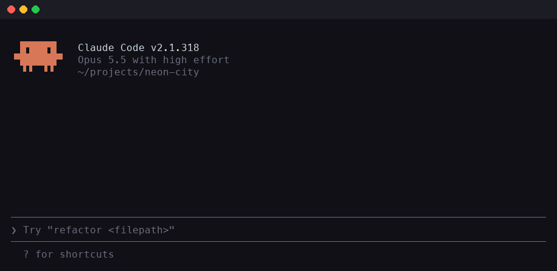
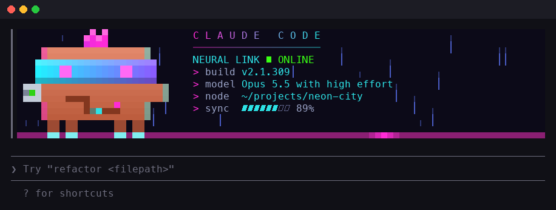

<div align="center">

# ▐▛███▜▌ CYBER//CLAWD

**Jack Claude Code's mascot into the grid.**

A Claude Code mod that boots a neon, glitching, cyberpunk Clawd up in place of the startup logo, and keeps it there.



[Install](#install) · [What it does](#what-it-does) · [Customize](#customize) · [How it works](docs/HOW-IT-WORKS.md) · [Limitations](#compatibility-and-limitations)

</div>

---

## What it does

When a new Claude Code session starts, the stock orange Clawd **dissolves into static**, a **cyan scan line** draws in a 9-row neon banner row by row, and **CyberClawd stays as your header** for the rest of the session.

| | |
|---|---|
| 🦀 **CyberClawd** | Pixel-art Clawd with a cyan-to-violet visor, a glint sweeping across it, blinking pink eyes, a pink mohawk, a chrome arm with a pulsing joint, a data pulse running along a chest circuit, and glowing boots |
| 🌧️ **The grid** | Falling neon rain, a magenta floor with a light running along it, and a glitch every few seconds that slips Clawd sideways with chromatic fringes |
| 📟 **The readout** | A flickering `C L A U D E   C O D E` title, plus everything the stock header said: your build, `Opus 5.5 with high effort · Claude Pro`-style model line, and working folder |
| ⌨️ **Out of your way** | The first keystroke skips straight to the finished banner. It scrolls away with the logo as the conversation grows and pauses its animation off screen |
| 🔐 **Cyberpunk spinner** | The thinking spinner says things like *Jacking in…*, *Decrypting…*, *Burning chrome…* and *Ghosting the firewall…*: 24 words, one per turn |



## Install

At the prompt of a Claude Code session in your terminal:

```
/plugin install cyber-clawd --marketplace liveinknewgithub/cyber-clawd
```

Answer `y` to add the marketplace and pick a scope (**user** puts it in every session). The spinner words work right away. **Start a new session** to see the banner boot up.

Or from a shell:

```sh
claude plugin install cyber-clawd --marketplace liveinknewgithub/cyber-clawd
```

In the desktop app, where `/plugin` does not run: click **+** next to the prompt box, then **Plugins**, **Add marketplace** with `liveinknewgithub/cyber-clawd`, then **Add plugin**.

### Turn on the fullscreen layout

The banner draws in Claude Code's **fullscreen** terminal layout, so turn it on in `~/.claude/settings.json`:

```json
{
  "tui": "fullscreen"
}
```

Without it you still get the cyberpunk spinner, and the startup header stays stock.

### Uninstall

```sh
claude plugin uninstall cyber-clawd
```

## Customize

Everything lives in three small files in [`hooks/`](hooks). Clone the repository, edit, and run your copy with `claude --plugin-dir ./cyber-clawd`.

| Change | Where |
|---|---|
| Spinner words | `WORDS` in [`hooks/spinner.ts`](hooks/spinner.ts) |
| Neon palette | The color constants at the top of [`hooks/banner.ts`](hooks/banner.ts) (`PINK`, `CYAN`, `VIOLET`, `FLOOR`, …) |
| The sprite | `SPRITE` in [`hooks/banner.ts`](hooks/banner.ts): a 24×18 pixel map with a letter per part (`V` visor, `M` mohawk, `C` chrome…), drawn two pixels to a terminal row |
| Readout lines | `textPanel()` in [`hooks/banner.ts`](hooks/banner.ts) |
| Speed and glitches | `TICK_MS`, `BOOT` and the `tick % 43` glitch timer in [`hooks/banner.ts`](hooks/banner.ts) |

More detail in [How it works](docs/HOW-IT-WORKS.md#customizing).

## Compatibility and limitations

- **Built on Claude Code 2.1.309.** CyberClawd is a *mod* (a plugin of function hooks), an API Claude Code marks as early access. It may change between releases.
- **Fullscreen layout only** for the banner (see above). The spinner works in the terminal, the desktop app and VS Code.
- **It draws *over* the stock logo.** Mods can't replace the logo itself, so CyberClawd paints over it from a row just below. The stock logo shows for a moment before the static starts, and the layout positions were measured on 2.1.309; a Claude Code update that rearranges the header can throw them off.
- **On most setups it runs `/cyber-clawd` once per new session.** The banner needs a row under the logo to draw from. When Claude Code shows a startup notice there (for example *Using … (from settings.json)*), CyberClawd uses it. Otherwise it runs its own `/cyber-clawd` command, whose output row hosts the banner. That leaves a `/cyber-clawd` line in the session's history, and the model sees a short note that you ran it locally (about 50 tokens).
- **Resumed sessions keep the stock header**, since the logo may not be where the banner expects it.
- **The header is three rows taller**, so the banner never covers your conversation.
- **Narrow terminals** (under 54 columns) get Clawd and the rain without the readout.

### What it reads

Only local things, and nothing leaves your machine: the Claude Code version, your working folder, the model and `effortLevel` / `modelSettings` / `modelPicker` settings for the model line, and the plan type (`organizationType`) from Claude Code's own `.claude.json` for the `· Claude Pro` part. With no signed-in account, the plan is left off.

## Development

```sh
claude plugin validate .   # what the engine will load, and anything it would refuse
claude plugin test .       # the tests in tests/
```

The README's GIF and still are rendered from the mod's own frame code with demo values:

```sh
bun scripts/dump-frames.ts frames.json
python3 scripts/render-media.py frames.json docs/media   # needs Pillow and ffmpeg
```

## License

[MIT](LICENSE). CyberClawd is an unofficial fan mod, not made or endorsed by Anthropic. Claude, Claude Code and Clawd belong to Anthropic.
